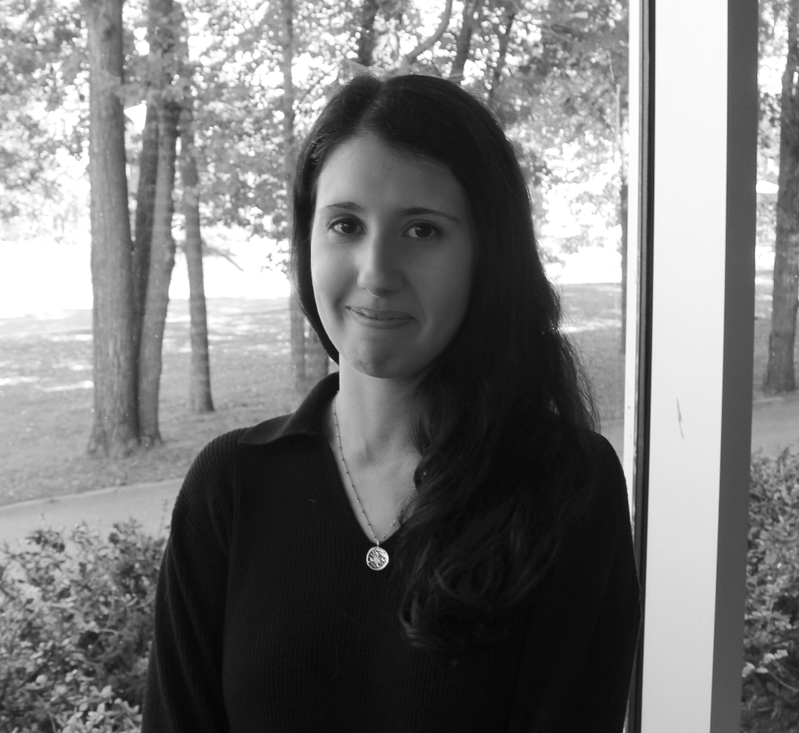

---
---

<link rel="stylesheet" href="styles.css" type="text/css">

---
---

<h1 style="font-size:209%; color:#2e8b57; text-align:left;">
Hello! I am Géraldine Jeckeln.
</h1>

<h1 style="font-size:120%;color:Black;text-align:left;">

My research focuses on how we process and identify faces, with a  particular emphasis on three interconnected areas: visual confidence, collaborative decision-making, and individual/group differences in ability. I study the cognitive processes that shape face-identification performance using methods from signal detection theory, psychometric modeling, and computational modeling. A central goal of my work is to develop methodological frameworks that deepen our understanding of face identification and support its application in real-world settings (e.g., security applications and criminal investigations).

Outside of research, helping stray and shelter dogs is something I care about a lot. Adopting my Texas Heeler, Bobby, in 2018 showed me how many animals end up in overcrowded shelters, and I’ve wanted to make a difference ever since. Working alongside rescue communities in Dallas and Nashville, I’ve volunteered at shelters, transported dogs, and fostered. I’m especially drawn to dogs with behavioural or medical needs because observing them heal, learn to trust, and thrive is incredibly rewarding.

<!--<h1 style="font-size:100%;color:Black;text-align:left;">
CV:
<a href="Jeckeln_CV2026.pdf" target="_blank" style="color:#2e8b57;">
Download CV (PDF)
</a>
</h1>-->

</h1>

<h1 style="font-size:100%;color:Black;text-align:left;">
Email address:
<a href="mailto:geraldine.jeckeln@uqo.ca" style= color:#2e8b57>geraldine.jeckeln@uqo.ca</a>
</h1>

<h1 style="font-size:110%;color:Black;text-align:left;">

Postdoctoral Fellow (CIRTA - SSHRC) , <a href="https://lpvs.uqo.ca/" style="color:#000000">LPVS</a>, Université du Québec en Outaouais (2026–present)  
Postdoctoral Research Associate,  <a href="https://labs.utdallas.edu/facelab/" style="color:#000000">Face Perception Research Lab</a>, University of Texas at Dallas (2024–2026) 
PhD, Cognition and Neuroscience, University of Texas at Dallas (2024) 
MS, Applied Cognition and Neuroscience, University of Texas at Dallas (2018) 
BA, Honours Psychology, Concordia University (2015)
</h1>

<link rel="stylesheet" href="https://cdn.jsdelivr.net/gh/jpswalsh/academicons@1/css/academicons.min.css">

</a> <a href="https://scholar.google.com/citations?user=gCJpjhUAAAAJ&hl=en" style= color:Black>
<i class="ai ai-google-scholar-square ai-2x"></i></a>    <a href="https://www.researchgate.net/profile/Geraldine-Jeckeln" style= color:Black>
<i class="ai ai-researchgate-square  ai-2x"></i></a>
<a href="#" style= color:Black>
<a href="https://osf.io/user/abvh3" style="color:black;">
  <i class="ai ai-osf-square ai-2x"></i>
</a>

